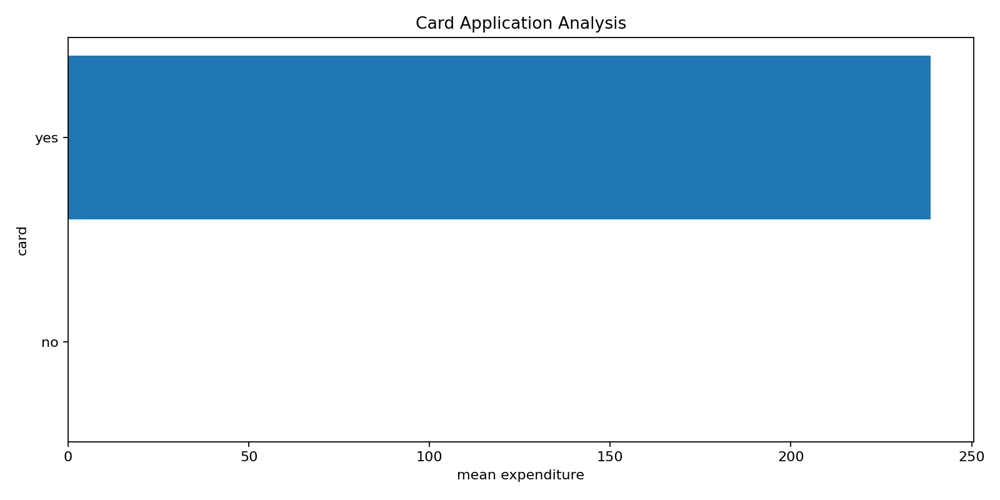

# Card Application Analysis — executed results

## Decision question
How do recorded expenditure values differ by card acceptance?

## Evidence
The largest observed mean expenditure is 238.602 for yes. This ranking is descriptive, not a recommendation.

Raw rows: 1,319. Rows used: 1,319. Excluded for missing/nonfinite required values or invalid denominator: 0.

## Method
Complete-case descriptive comparison of expenditure by card; show group counts, mean, minimum and maximum.

## Interpretation and limitations
Expenditure zeros and acceptance selection require source interpretation; this is not a validated lending model. No causal inference, significance claim or production deployment is implied. Missing values are not imputed; identical rows are retained. Small or repeated samples limit uncertainty interpretation.

## Recommended next decision
Audit zero expenditures and selection before customer segmentation.

## Reproducibility
Source and exact downloaded-byte SHA256 are recorded in run_manifest.json. SQL results are in answer.csv and analysis.sqlite. Review quality_audit.csv before interpretation.
